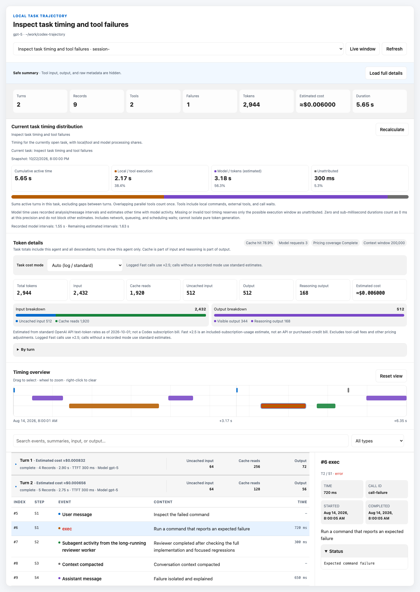

# Codex Trajectory

[](https://github.com/icesixgod/codex-trajectory/actions/workflows/ci.yml)
[](https://github.com/icesixgod/codex-trajectory/releases/latest)
[](LICENSE)

**English** · [简体中文](README.zh-CN.md)

See what a Codex task did, where time went, and how many tokens it used. Codex Trajectory turns local task logs into a searchable timeline and event ledger.

- **Replay tasks:** inspect messages, saved reasoning summaries, tool calls, failures, subagent activity, and context compaction.
- **Find slow work:** see durations and percentages for tools, estimated model time, and unattributed time in the selected task.
- **Track usage:** view tokens, cache usage, and estimated costs, including all descendant subagents in task totals. Turn details show the selected agent only.
- **Follow live activity:** watch new events, token totals, and the latest local quota sample.



*Current viewer, captured October 22, 2026 with synthetic demo data.*

## Install

Requires **Codex desktop** and **[uv](https://docs.astral.sh/uv/getting-started/installation/)**. Supports macOS, Linux, and Windows.

```sh
codex plugin marketplace add icesixgod/codex-trajectory
codex plugin add codex-trajectory@icesixgod
```

After installing, open a new Codex task. After updating, fully quit and reopen Codex.

## Use

1. In the task's right panel, select **+ → More tools… → Plugins and MCPs → Codex Trajectory**. This opens the current task without a model turn; if task context is unavailable, choose a local task.
2. Search or filter the event ledger, then click a record to inspect it. Use **Load earlier records** for more history.
3. Click **Calculate task timing** for the timing breakdown, or **Live window** to follow new activity.

You can also open the viewer through `show_codex_trajectory` by asking Codex:

> Show the safe trajectory summary for this Codex task.

For MCP calls, pass an explicit `sessionId` to select a task. Without it, read/show tools use the most recently modified active task.

Timing excludes gaps between turns and counts overlapping tools once. Model time includes network and queueing waits. Costs use bundled API prices and are estimates, not subscription charges; local quota samples may lag.

If a log exceeds **512 MiB**, raise **Read limit (GB)** in the error panel and click **Enable and retry**. The limit applies only to that task in the current panel.

## Privacy

Logs are read locally and remain unchanged. **Safe summary** hides tool inputs, outputs, and raw metadata; **Load full details** requires confirmation and can remember your choice. Live views always use safe summaries.

Data returned through Codex may enter the active conversation. See the [privacy policy](PRIVACY.md) for details.

## Documentation

[MCP tools and API](docs/interface.md) · [Troubleshooting](docs/native-viewer.md) · [Development](CONTRIBUTING.md) · [Changelog](CHANGELOG.md)

## License and credits

[MIT](LICENSE). Parts of the UI are adapted from [DeepSeek Harness](https://github.com/deepseek-ai/deepseek-harness/tree/master/packages/client/ui-trajectory), © 2026 DeepSeek. See [NOTICE](NOTICE) and the [upstream license](LICENSES/DeepSeek-Harness.txt). Independently maintained; not affiliated with DeepSeek.

Friendly link: [Linux.do](https://linux.do/)
