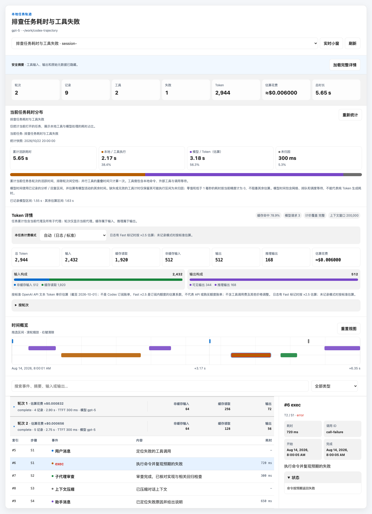

# Codex Trajectory

[](https://github.com/icesixgod/codex-trajectory/actions/workflows/ci.yml)
[](https://github.com/icesixgod/codex-trajectory/releases/latest)
[](LICENSE)

[English](README.md) · **简体中文**

看清 Codex 任务做了什么、时间花在哪里、用了多少 Token。Codex Trajectory 将本地任务日志整理成可搜索的时间轴和事件账本。

- **回看过程：**查看消息、已保存的推理摘要、工具调用、失败、子代理活动和上下文压缩。
- **定位耗时：**展示当前任务中工具执行、模型估算和未归因时间的时长与占比。
- **统计用量：**查看 Token、缓存命中和估算费用；任务总量包含所有层级子代理，轮次明细仅显示当前代理。
- **跟随实时活动：**查看新增事件、Token 总量和本地最新额度采样。



*2026 年 10 月 22 日截取当前界面，使用合成演示数据。*

## 安装

需要 **Codex 桌面版**和 **[uv](https://docs.astral.sh/uv/getting-started/installation/)**，支持 macOS、Linux 和 Windows。

```sh
codex plugin marketplace add icesixgod/codex-trajectory
codex plugin add codex-trajectory@icesixgod
```

安装后新建一个 Codex 任务。更新插件后，请完整退出并重新打开 Codex。

## 使用

1. 在任务右侧面板选择 **+ → More tools… → Plugins and MCPs → Codex Trajectory**，直接打开当前任务，无需触发模型对话；无法获取任务上下文时，手动选择本地任务。
2. 搜索或筛选事件，点击记录查看详情；点击**加载更早记录**浏览历史。
3. 点击**统计当前任务耗时**查看耗时分布，或点击**实时小窗**跟随新增活动。

也可以让 Codex 通过 `show_codex_trajectory` 打开查看器：

> 展示当前 Codex 任务的安全轨迹摘要。

通过 MCP 调用时，请传入 `sessionId` 指定任务；未指定时，读取和展示工具默认选择最近修改的活跃任务。

耗时统计排除轮次间空档，并行工具重叠时间只计一次；模型时间包含网络和排队等待。费用按内置 API 价格估算，不等于订阅账单；本地额度采样可能滞后。

日志超过 **512 MiB** 时，可在错误提示中提高**读取上限（GB）**并点击**启用并重试**，仅对当前面板中的该任务生效。

## 隐私

日志在本地读取，源文件保持不变。默认的**安全摘要**隐藏工具输入、输出和原始元数据；**加载完整详情**需要确认，也可记住这一选择。实时视图始终使用安全摘要。

通过 Codex 返回的数据可能进入当前对话，详见[隐私说明](PRIVACY.md)。

## 文档

[MCP 工具与接口](docs/interface.md) · [故障排查](docs/native-viewer.md) · [开发指南](CONTRIBUTING.md) · [更新日志](CHANGELOG.md)

## 许可与致谢

采用 [MIT 许可证](LICENSE)。部分界面改编自 [DeepSeek Harness](https://github.com/deepseek-ai/deepseek-harness/tree/master/packages/client/ui-trajectory)，© 2026 DeepSeek，详见 [NOTICE](NOTICE) 和[上游许可证](LICENSES/DeepSeek-Harness.txt)。本项目独立维护，与 DeepSeek 无隶属关系。

友情链接：[Linux.do](https://linux.do/)
